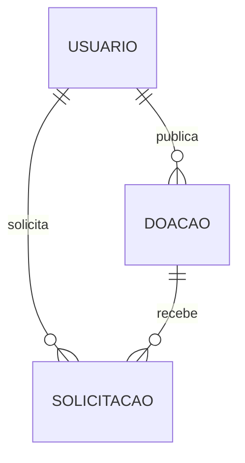

# Modelo conceitual inicial — Refeição Solidária

**Jira:** REF-15 · **Sprint:** 1 · **Situação:** proposta para discussão.

O projeto de referência da API modela três entidades principais: `Usuario`, `Doacao` e `Solicitacao`. O fluxo de transporte aparece na interface web, mas não existe como uma das três entidades centrais na API de referência.

## Entidades

### Usuario

Dados previstos: identificador, nome, documento, e-mail, senha, telefone, endereço, tipo (`DOADOR`, `INSTITUICAO`, `VOLUNTARIO`, `ADMIN`), aprovação e data de cadastro. No modelo de referência, documento e e-mail são únicos.

### Doacao

Dados previstos: identificador, doador, nome do alimento, descrição, quantidade disponível, preparo, validade de consumo, conservação, local e limite de retirada, foto e status.

Status previstos: `DISPONIVEL`, `PARCIALMENTE_RESERVADA`, `TOTALMENTE_RESERVADA`, `AGUARDANDO_RETIRADA`, `CONCLUIDA`, `CANCELADA`.

### Solicitacao

Dados previstos: identificador, doação, instituição solicitante, quantidade solicitada, status, motivo de cancelamento e data da solicitação.

Status previstos: `PENDENTE`, `APROVADA`, `RECUSADA`, `CANCELADA`.

## Relacionamentos

- Uma doação pertence a um usuário doador; um doador pode publicar várias doações.
- Uma solicitação pertence a uma doação e a uma instituição; uma instituição pode abrir várias solicitações.
- A modelagem deverá validar na camada de negócio se o tipo de usuário está adequado ao papel executado.

## Decisões para revisar na equipe

- Validar campos obrigatórios e restrições de quantidade/validade quando implementarmos o domínio.
- Definir a atualização dos saldos após aprovação e cancelamento das solicitações.
- Não antecipar tabelas para transporte enquanto a integração não fizer parte do escopo da API.
- Não usar o `docker-compose.yml` como prova de que as tabelas JPA já foram implementadas.

## Verificação da Sprint 1

- [ ] Relacionamentos revisados com o gerente e o back-end.
- [ ] Serviços PostgreSQL e pgAdmin iniciados e testados localmente.
- [ ] Decisões pendentes registradas antes da implementação JPA nas próximas sprints.
